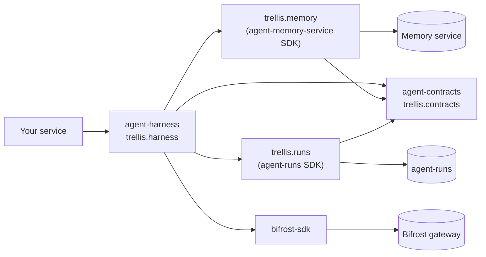

# trellis-harness

Trellis gives an agent you already built the platform around it: memory of the people it works
for, tools and MCP tools through the Bifrost gateway, governance of every tool call and a person
in the loop, durable runs that wait for a person and survive a restart, evaluation, tracing,
and AG-UI and A2A serving. The agent stays what it is — a LangGraph graph (Deep Agents
included), an OpenAI Agents SDK `Agent`, a Claude Agent SDK setup, a `ReAct` agent for teams
with no framework, or a plain async function — and the framework is neither modified nor
re-implemented.

## Start here

Three steps: build the agent, wrap it, run it. The walkthrough below is one program — CI runs
it as it is written here (`make examples`, offline: a scripted model answers; `make
examples-live` against your services), so it cannot go stale.

<!-- walkthrough: scripts/run_readme.py runs the python blocks from here to its end -->

**1. Build** the agent — with your framework, or with `ReAct` when you have none. A tool says
what it does to the world: `read` runs, `irreversible` waits for a person.

```python
from trellis import Harness, ReAct, tool


@tool(side_effects="read")
def stock(sku: str) -> int:
    """Units of a SKU in stock.

    Args:
        sku: the SKU, like "SKU-1"
    """
    return {"SKU-1": 3}.get(sku, 0)


@tool(side_effects="irreversible")
def reorder(sku: str, qty: int) -> str:
    """Order more units of a SKU from the supplier.

    Args:
        sku: the SKU, like "SKU-1"
        qty: how many units to order
    """
    return f"ordered {qty} x {sku}"


target = ReAct(
    system_prompt="You keep stock above 10 units.",
    model="openai/gpt-4.1-mini",  # through Bifrost when BIFROST_URL is set, else OPENAI_API_KEY
    tools=[stock, reorder],
)
```

**2. Wrap** it. The `Harness` reads the deployment from the environment — each service is on
when its variable is set, and with none set everything runs in this process. What applies to
every run of this agent goes on `h.wrap`.

```python
h = Harness()
agent = h.wrap(target, id="stock-keeper", run_timeout=300)
```

**3. Run** it where you called the framework. What applies to one run goes on the run.

```python
result = await agent.run("Is SKU-1 low? Top it up if so.", user="ada")
while result.interrupt is not None:  # reorder is irreversible: the run waits for a person
    print("waiting for a person:", result.interrupt.question)
    result = await agent.resume(result.interrupt.interrupt_id, "approve", reviewer="lee")
print(result.status.value, result.answer)
await h.aclose()
```

<!-- /walkthrough -->

An agent you already built is wrapped the same way — `h.wrap(graph, id=...)`, an OpenAI
`Agent`, your `ClaudeAgentOptions`, an async function — and keeps its own tools, each governed
as the framework runs it. One page per framework says what to add to an existing project:
[LangGraph and LangChain](docs/frameworks/langgraph.md), [Deep Agents](docs/frameworks/deepagents.md),
[OpenAI Agents SDK](docs/frameworks/openai-agents.md),
[Claude Agent SDK](docs/frameworks/claude-agent-sdk.md), [ReAct](docs/frameworks/react.md),
[plain functions](docs/frameworks/functions.md); which feature works with which:
[docs/matrix.md](docs/matrix.md), written from the tests. Run it now, with no services:

```bash
make install                         # uv sync (the sibling repositories are path sources)
.venv/bin/python -m examples.01_start.hello
.venv/bin/python -m examples.01_start.first_agent   # a model, two tools, an approval
```

### Where things go

Each thing has one place, decided by who owns it and how often it changes; the full table, with
every setting and argument: [docs/configuration.md](docs/configuration.md#where-each-thing-goes).

| Place | What goes there |
|---|---|
| the environment | where each service is and its key: `BIFROST_URL`, `BIFROST_VIRTUAL_KEY`, `MEMORY_URL`, `RUNS_URL`, `TRELLIS_API_KEY` (and `OTEL_*`, `LANGFUSE_*`, the providers' keys, read by their own SDKs) |
| the services | Bifrost: model routing, fallbacks, budgets, MCP tools, stored prompts; the memory catalog: tool risk and approval rules; agent-runs: schedules |
| the builder (`ReAct` or your framework's) | the model, the instructions, the tools, the output schema, sub-agents |
| `h.wrap(...)` | every run of the agent: `hooks`, `judges`, `budget`, `run_timeout`, `without`, `framework_options` |
| `agent.run(...)` | this run: `user`, `thread`, `run_timeout`, `deadline`, `budget`, `without`, `framework_options` |

### Bifrost or a provider key

A model name is routed one way for every framework. With `BIFROST_URL` set, every model call
goes through Bifrost on `BIFROST_VIRTUAL_KEY` — and Bifrost wins when a provider key is set
too. Without it, a name goes to its provider's own SDK, which reads its own key
(`OPENAI_API_KEY`, `OPENAI_BASE_URL` for any OpenAI-compatible endpoint, `ANTHROPIC_API_KEY`):
models only — the MCP tools, Code Mode, stored prompts and dollar budgets are Bifrost's
([configuration.md](docs/configuration.md#where-a-model-name-goes),
[examples/05_features/model_routing.py](examples/05_features/model_routing.py)).

## What do I need?

| I need | One line | More |
|---|---|---|
| my existing agent with memory, approvals and traces | `agent = h.wrap(graph, id="triage")` | [frameworks](docs/README.md#way-1-wrapped-the-harness-runs-your-agent) |
| a tool-calling agent, no framework | `h.wrap(ReAct(system_prompt="...", model="provider/model", tools=[...]), id="a")` | [react.md](docs/frameworks/react.md) |
| the agent to remember the user | `export MEMORY_URL=... TRELLIS_API_KEY=...` | [memory.md](docs/memory.md) |
| a tool of my own | `ReAct(..., tools=[lookup])`, or your framework's own tool (governed as it runs) | [tools.md](docs/tools.md) |
| the gateway's MCP tools | `export BIFROST_URL=... BIFROST_VIRTUAL_KEY=...` | [gateway.md](docs/gateway.md) |
| a person to approve a risky call | `@tool(side_effects="irreversible")`, then `agent.resume(id, "approve", reviewer="lee")` | [governance.md](docs/governance.md) |
| to ask a person something | `await trellis.current().ask("Which plan?", options=["basic", "pro"])` | [interrupts.md](docs/interrupts.md) |
| a rule of my own around calls | `h.wrap(target, id="a", hooks=[MyRule()])` | [hooks.md](docs/hooks.md) |
| runs that outlive the process | `await agent.start(...)` and `python -m trellis.harness.worker app:h` | [runs.md](docs/runs.md) |
| a run on a cadence | `await agent.schedule("weekdays", user="ada", input="Digest")` | [runs.md](docs/runs.md#schedules) |
| a part turned off | `await agent.run(q, user="ada", without={"memory"})` | [configuration.md](docs/configuration.md#what-is-on-and-how-to-turn-it-off) |
| a time limit | `h.wrap(target, id="a", run_timeout=600)` | [reliability.md](docs/reliability.md) |
| the framework's own options | `h.wrap(graph, id="a", framework_options={"recursion_limit": 50})` | [configuration.md](docs/configuration.md#the-frameworks-own-run-options) |
| sub-agents | `ReAct(..., subagents=[scout])` | [subagents.md](docs/subagents.md) |
| a chat UI, or other agents calling mine | `agent.serve_chat(app)`, `agent.serve_a2a(app, url)` | [surfaces.md](docs/surfaces.md) |
| to call another agent | `ReAct(..., subagents=[a2a("https://...")])`, or `await a2a("https://...")(message)` | [surfaces.md](docs/surfaces.md) |
| a score for a test set | `await h.evaluate(agent, dataset, [exact_match(), called("lookup")])` | [evaluation.md](docs/evaluation.md) |
| quality on live traffic | `h.wrap(target, id="a", judges=[llm_judge("Polite and correct.")])` | [evaluation.md](docs/evaluation.md) |
| traces in Langfuse | `export LANGFUSE_PUBLIC_KEY=... LANGFUSE_SECRET_KEY=...` (`LANGFUSE_HOST=...` unless on Langfuse Cloud) | [observability.md](docs/observability.md) |
| code run away from the host | `ReAct(..., backend=docker_sandbox())` (Docker) | [sandbox.md](docs/sandbox.md) |
| only one piece, in my own loop | `from trellis.memory import MemoryClient` (or runs, governance, evals) | [Way 2](#two-ways-to-use-trellis) |

Every line has a runnable example: [examples/](examples/README.md).

## Two ways to use Trellis

**Way 1, wrapped: the harness runs your agent.** `h.wrap(agent)` attaches every piece at once,
and you call `agent.run` where you called the framework. Around each run the harness pushes the
memory context in, governs every tool call, pauses for approvals in agent-runs and resumes them
without repeating a side effect, records the transcript and every call, judges a sample of
answers and traces it all.

**Way 2, pluggable blocks: your framework, our pieces.** Your framework keeps running the agent,
untouched, and your code calls the blocks it wants where it chooses: `trellis.memory`,
`trellis.runs` (durable runs, the inbox, workers, webhooks), `trellis.harness.governance`,
`trellis.harness.evals`, `a2a(url)` (`from trellis import a2a`). Your framework's own pause (a LangGraph
checkpointer and `interrupt`, an OpenAI Agents `RunState`, a Claude session) stays the pause.

**Without the harness: the SDKs alone.** `trellis.memory`, `trellis.runs`, `trellis.contracts`
and `bifrost_sdk` are separate distributions; code that needs no governance or evaluation
stitches only them into its own LangGraph or Deep Agents code
([examples/04_no_harness](examples/README.md#04_no_harness-only-the-sdks)).

All three use the same services and the same records, so one deployment mixes them
([mixing both ways](docs/blocks/mixing.md)).

| Question | Way 1, wrapped | Way 2, blocks |
|---|---|---|
| Should Trellis run your agent loop? | Yes: `agent.run`, `agent.stream`, `agent.start` call the framework for you | No: you call `graph.ainvoke`, `Runner.run`, `query()` as today |
| Do you need to serve the agent over AG-UI or A2A? | `agent.serve_chat(app)`, `agent.serve_a2a(app, url)` | Serving is the harness's; *calling* A2A agents is a block (`a2a(url)`) |
| Should durable pause and resume be handled for you? | Yes: the resumed run replays its journal, so no question is asked twice and no side effect repeats | You keep your framework's state and hand agent-runs its checkpoint |
| Is the framework code something you cannot change? | It is unchanged, but its runs go through `agent.run` | Nothing changes: the blocks are calls around it |
| Do you want only one capability? | You get all of them, each on with its service; turn parts off with `without=` | Import that one block |

## The five repositories



| Repository | Distribution (import) | What it is |
|---|---|---|
| [agent-harness](https://github.com/amitmohapatra/agent-harness) (this one) | `trellis-harness` (`trellis`, `trellis.harness`) | the harness: Way 1, and the governance, evaluation and A2A blocks |
| [agent-memory-service](https://github.com/amitmohapatra/agent-memory-service) | `trellis-memory` (`trellis.memory`) | the memory service and its SDK: context, records, documents, the tool catalog, feedback |
| [agent-runs](https://github.com/amitmohapatra/agent-runs) | `trellis-runs` (`trellis.runs`) | durable runs: records, the queue and leases, pauses, the inbox, schedules, webhooks |
| [agent-contracts](https://github.com/amitmohapatra/agent-contracts) | `trellis-contracts` (`trellis.contracts`) | the records every block takes and returns |
| [bifrost-sdk](https://github.com/amitmohapatra/bifrost-sdk) | `bifrost-sdk` (`bifrost_sdk`) | the client of the Bifrost gateway: models, MCP tools, prompts |

How they fit, and the harness inside: [docs/architecture.md](docs/architecture.md). Which
versions this release was tested with: [docs/versioning.md](docs/versioning.md).

## Install

The platform is not published to PyPI yet: install from source, with the sibling repositories
checked out next to this one — they are path dependencies (`[tool.uv.sources]` in
`pyproject.toml`):

```bash
mkdir trellis && cd trellis
for repo in agent-contracts bifrost-sdk agent-memory-service agent-runs agent-harness; do
  git clone https://github.com/amitmohapatra/$repo.git
done
cd agent-harness
uv sync --all-extras    # the core, every framework extra and the dev tools, in .venv
```

Into an environment of your own, with pip, the siblings first:

```bash
pip install -e ../agent-contracts -e ../bifrost-sdk -e ../agent-memory-service/sdk/python \
  -e ../agent-runs/sdk/python
pip install -e '.[langgraph]'    # or any extras, below
```

One distribution; each framework is an extra (the core imports none of them), pinned to the
range this release was tested with: `langgraph` (LangGraph and LangChain's `create_agent`),
`deepagents`, `react` (`ReAct`), `openai-agents`, `claude-agent-sdk`, `agui` (`serve_chat`),
`a2a` (`serve_a2a`, `a2a()`), `otel` (OTLP export), `all`. A Way 2 team that wants
only `trellis.memory`, `trellis.runs` or `trellis.contracts` installs that one sibling.

## Configuration

The environment holds the endpoints and keys: `BIFROST_URL`, `BIFROST_VIRTUAL_KEY`,
`TRELLIS_JUDGE_VIRTUAL_KEY` (optional), `TRELLIS_API_KEY`, `MEMORY_URL`, `RUNS_URL` and
`TRELLIS_SPOOL_DIR`; the tools' own standard variables (`OTEL_*`, `LANGFUSE_*`, `DOCKER_HOST`,
the providers' keys) are read by their SDKs. Everything else is in
code; `trellis doctor` prints each setting and where it came from. Each one, its default, an
example and what it turns on: [docs/configuration.md](docs/configuration.md) (and
[`.env.example`](.env.example)). A real deployment, from running services to a configured
application: [docs/onboarding.md](docs/onboarding.md).

## Documentation

| Page | |
|---|---|
| [docs/README.md](docs/README.md) | the map: every page, by way and by feature |
| [docs/api.md](docs/api.md) | every public name, its arguments and defaults |
| [docs/configuration.md](docs/configuration.md) | every setting, what is automatic, `without=`, `framework_options=` |
| [docs/architecture.md](docs/architecture.md) | the five repositories, then the harness inside (diagrams) |
| [docs/flows.md](docs/flows.md) | sequence diagrams of each flow, written from the code |
| [docs/scenarios.md](docs/scenarios.md) | which feature to use when |
| [docs/troubleshooting.md](docs/troubleshooting.md) | what an error means and what to do |
| [docs/versioning.md](docs/versioning.md) | tested versions, the policy, how to upgrade |
| [examples/README.md](examples/README.md) | every example, simple to complex |
| [CHANGELOG.md](CHANGELOG.md) | what changed in each release |

## Development

```bash
make install       # uv sync (the sibling trellis checkouts are path sources)
make check         # ruff, pyright, tests at 100% coverage
make examples      # every example, offline, in parallel
make matrix        # the generated feature matrix (build/matrix.md)
make docs-check    # links, anchors, and every snippet against the real API
make bench         # the overhead benchmark against benchmark-results.json
make test-live     # opt-in tests against BIFROST_URL / MEMORY_URL / RUNS_URL / TRELLIS_API_KEY
```

`make test-live` reads the deployment environment and skips whatever is unset or unreachable;
`tests/live/conftest.py` says what it registers in the gateway for the session. The memory
service in the tests is an in-process fake behind the real SDK, and every request and answer
is checked against the service's committed `docs/openapi.json`; `tests/contract` does the same
for agent-runs. The documents are read from the sibling checkouts, or from
`TRELLIS_MEMORY_OPENAPI` / `TRELLIS_RUNS_OPENAPI`.
