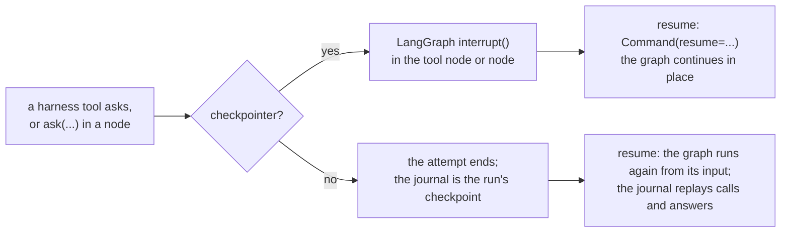

# LangGraph and LangChain

A compiled LangGraph graph is a target: LangChain v1's `create_agent` (it returns one), a
`StateGraph` you built by hand, with or without a checkpointer. Deep Agents is a LangGraph graph
too, with a page of its own ([deepagents.md](deepagents.md)).

**Install:** `pip install 'trellis-harness[langgraph]'` (LangGraph, `langchain-core` and
`langchain`, which has `create_agent` and its middleware). Your model is your own LangChain chat
model (with Bifrost set, a model of yours that does not go through it is said once); a stored
prompt of the gateway is `system_prompt=(await h.prompt("triage")).text`, or pinned per run
with `create_agent(..., middleware=[ModelHooks(prompt=stored("triage"))])`
([prompts.md](../prompts.md)).

This page is Way 1: the harness runs the graph. To keep calling the graph yourself and plug in
the blocks (memory, governed tools asking through `interrupt`, the pause in agent-runs, a
judge), see the Way 2 recipe: [blocks/langgraph.md](../blocks/langgraph.md).

## Using an existing LangGraph project

Your graph stays as it is, its tools too. Two changes, and one addition if you want the
harness's tools:

```python
from langchain_core.tools import tool
from trellis import Harness
from trellis.harness.middleware import HarnessTools

h = Harness()  # the deployment is the environment


@tool
def reorder(sku: str, qty: int) -> str:
    """Order more units of a SKU."""  # the catalog says it is irreversible: a person approves
    ...


# 1. your graph, with HarnessTools for the gateway's MCP tools and the memory tools
#    (or middleware=trellis.middleware(): all of ReAct's harness part, below)
graph = create_agent(model, tools=[stock, reorder], middleware=[HarnessTools()], checkpointer=saver)
#    ...or your own StateGraph: ToolNode([stock, reorder]), model.bind_tools(...)

# 2. wrap it
agent = h.wrap(graph, id="stock-keeper")

# 3. call the agent where you called the graph
result = await agent.run("Is SKU-1 low?", user="ada", thread="ticket-7")  # was graph.ainvoke
async for event in agent.stream("Is SKU-1 low?", user="ada"):
    ...  # was graph.astream
result = await agent.resume(result.interrupt.interrupt_id, "approve", reviewer="lead")
```

The graph's own tools are governed as its tool node runs them — the catalog's risk and rules,
approvals, the journal, the records — their risk the tool catalog's (an administrator's, in the
memory service; without it, a write). `HarnessTools` offers the harness's tools at each model
call: every MCP tool the Bifrost virtual key allows and — memory on — the memory tools
(`memory_search`, `memory_remember`, `memory_update`, `memory_forget`, `profile_edit`,
`tool_search`). A hand-built graph takes the memory tools alone with `await h.memory_tools()`.

**`graph.invoke` itself is not intercepted.** The harness runs the graph through
`agent.run` / `agent.stream` / `agent.resume` / `agent.start`; called directly, the graph runs
without memory, run records or traces, and a harness tool refuses to run (`ToolError`: "runs
inside a Harness run"). Config the graph needs at run time goes in the
input, the graph's defaults or `graph.with_config(...)` before wrapping (still a graph); the
harness sets `configurable.thread_id` itself (the run's conversation, else the run id). The
conversation is the tenant's, the user's and the thread's, so two users giving the same
`thread=` never share a checkpointer thread; to read your graph's state yourself, ask for its
key: `graph.aget_state({"configurable": {"thread_id": await h.conversation(user="ada",
thread="t-7")}})`.

## middleware(): ReAct's harness part on your graph

`create_agent(model, tools, middleware=trellis.middleware(...))` gives a `create_agent` graph
everything `ReAct` adds on top of
Deep Agents: the run's tools per model call narrowed per turn (the memory and gateway MCP tools
among them), the graph's own tools governed, `max_steps` (LangChain's model call limit), the stall guard,
the hooks and spans, `call_timeout`, the budget's stop, planning on a long task, older results
cleared and read back with a `context_window`, the request fitted to the window, and its
checkpoint in the run: compiled without a checkpointer, it is run with `RunCheckpointer()`, so a
resume after a pause or a crash continues where it stopped
([react.md](react.md#middleware-on-your-own-graph), [runs.md](../runs.md#continuing-where-a-run-stopped)). A `create_agent` graph wrapped without it
is still narrowed and governed, said once at `h.wrap`.

## What is automatic

| | |
|---|---|
| Memory push | the context for the question arrives as a leading `SystemMessage` with the fixed id `trellis-memory-context` — with a durable checkpointer, one per thread, replaced each turn, and asked for *without* the recent conversation (the checkpointer holds it). Without one (`ReAct`, a `create_agent` graph without a checkpointer) memory keeps the conversation: its recent turns follow the context as LangChain's own messages — `HumanMessage`, `AIMessage` with its `tool_calls`, `ToolMessage` — as a checkpointer would replay them, and each run's question, tool calls, results and answer are written back before it returns. An `InMemorySaver` (`MemorySaver`) loses the thread on a restart, so memory's window stays on with it, in the context's text (the saver replays the thread while the process lives), said once (`trellis.harness.history`). The input: a string (one user message), a message list, or a dict with `messages`; any other state dict passes through untouched (read `trellis.current().context` in a node) |
| Memory pull | the memory tools come with `HarnessTools`; for a hand-built graph, `await h.memory_tools()` is the memory block alone: LangChain tools for its `ToolNode` and `model.bind_tools`, each call made in the scope of the run calling it (refused outside a run) |
| Long-term store | a graph compiled without a `store` gets the memory service as its `BaseStore` per run (`runtime.store`, `get_store()`): each item one memory of the user's. A graph compiled with its own store keeps it (said once); `without={"memory"}` leaves the graph as built |
| Records | the transcript (the question and the final AI message), every tool call, the run's `system` outcome; approvals as `TOOL_CALL` feedback |
| Governance and approvals | every tool call — the graph's own and the harness's — is governed by the catalog as it is at the call (a rule set after the graph was compiled applies) |
| Tool hints | the context is asked for with the toolbox's names (5 or more); from 30 tools in the run, a `create_agent` graph is offered, at each model call, only the tools the run offers — the hinted ones, the memory tools, those already used, what a `tool_search` found (`narrows="turn"`): the harness runs a copy of it whose model calls go through one more `awrap_model_call` handler, innermost, so your graph object is unchanged. A hand-built `StateGraph` binds its model's tools itself: not narrowed (`narrows="none"`), but its `ToolNode`'s calls are governed, journaled and recorded as the run's |
| Large results and compute | a `create_agent` or Deep Agents graph with `middleware()` (`HarnessTools`) and one without it alike: a result of a harness tool over 80,000 characters is kept in the run and previewed, a table of many rows read whole is kept too, and once the run keeps one the model is offered `read_file` (its pages) and `query_result` (read-only SQL over its rows: a count, a sum or a ranking exact, not done by hand). Without `middleware()` the harness's narrowing copy offers them, as schemas (`create_agent` refuses a tool object its `ToolNode` lacks), and the tool node answers them: it checks a call's tool only where the harness governs it. A hand-built `StateGraph` binds its model's tools itself, so none is offered there: build it with `create_agent` to have them |
| Grounding, judges | sampled successful runs with an answer ([evaluation.md](../evaluation.md)) |
| Hooks | the tool and run hooks as for every target; a model call is LangChain's own middleware, given when the graph is built: `create_agent(model, tools=..., middleware=[yours, ModelHooks()])` (`from trellis.harness.middleware import ModelHooks`: the span, `call_timeout`, a failed call's `on_error`; the other harness middleware — the run's tools per model call, a step limit, stall detection, the checkpoint in the run — is in [react.md](react.md#the-middleware)) — a hand-built `StateGraph` calls its model itself: none ([hooks.md](../hooks.md)) |
| Tracing | one `invoke_agent` span per attempt, `execute_tool` per tool call, `retrieve memory`; LangChain's own instrumentation nests under it |

The answer is the state's `structured_response` (a `response_format`) or the last AI message's
text.

## Approvals and pauses

| Pause | With a checkpointer | Without one |
|---|---|---|
| a tool that asks (`irreversible`, a catalog `approve_when`) | LangGraph's `interrupt` inside the tool node; `resume` is `Command(resume=...)` — the graph continues in place, the model is not asked again | the run re-runs from its input as the next attempt; the journal returns the tool calls already made and the answer given (the model *is* asked again) |
| `trellis.current().ask(...)` in a node or tool | the same | the same |
| the graph's own `interrupt(value)` | a question (`value["question"]` or the value); a dict `value` also carries `options` (strings or `{"value", "label", "description"}`), `multiple`, `expects`, `ui_schema`, `component`, `props` and `assignee` onto the `Interrupt` exactly as `ask(...)` does (the same code: `Question.described`), refused as `ask` refuses them (the run fails saying why); the answer is checked as any answer is (`answer_problem`: an option's value, a list of them with `multiple`, a fit to `expects`) and resumed raw, `Command(resume=answer)` | refused: the run fails saying the graph needs a checkpointer |
| `HumanInTheLoopMiddleware(interrupt_on=...)` | an approval of the calls it holds (the first in `tool_call`, the whole request in `payload`), answered with the middleware's own decisions | needs a checkpointer |



```python
from langgraph.types import interrupt


def pick(state: State) -> dict:
    plans = interrupt(
        {
            "question": "Which plans?",
            "options": [{"value": "a", "label": "Plan A"}, "b"],
            "multiple": True,
            "component": "plan-picker",  # your own screen, where a surface has it
            "props": {"customer": state["customer"]},
            "assignee": "role:sales",
        }
    )
    return {"plans": plans}  # ["a", "b"]: the answer as given, checked against the options
```

Every pause is a contracts `Interrupt` in the run store (agent-runs with `RUNS_URL`), in the
inbox, answered the same way: `approve`, `reject` (with `answer="why"`, the reason the model
reads), `edit` (the edited arguments), `answer`, `cancel`. The middleware's mapping is in
[interrupts.md](../interrupts.md#framework-approvals-langchains-middleware-and-openai-agents-needs_approval).
Gate a tool in one place: a tool the middleware covers is `side_effects="write"` or `"read"` in
the harness, or each call is approved twice.

**Which checkpointer.** A pause resumes in place only where the checkpointer still holds it:
`InMemorySaver` holds it in the process that paused, and nowhere else. Resumed elsewhere — by a
worker, another replica behind AG-UI, after a restart — a pause of the harness's own (an
approval, an `ask`) is answered from the run's journal instead: the graph runs again from its
input, as without a checkpointer (the model is asked again; the calls already made replay, the
approved one runs once). A graph's own `interrupt()` and the middleware's pause can only be
answered by the checkpointer: resumed where it does not hold them, the run fails saying so. When
those may be resumed in another process, give every process a shared, durable checkpointer
(`langgraph-checkpoint-postgres`'s `AsyncPostgresSaver`). A worker that dies leaves such a
checkpointer the run's latest checkpoint (marked `trellis_run_id`), and the next worker
continues from it ([runs.md](../runs.md#continuing-where-a-run-stopped)). A graph built with
`middleware()` and no checkpointer keeps its checkpoint in the run: every process holds it.

## The graph's own run options

`framework_options=` (on `h.wrap`, or a run's own on `run`/`stream`/`start`) goes into the config
the harness calls `ainvoke`/`astream` with: `recursion_limit`, `configurable` keys your nodes
read, `tags`, `metadata`, `callbacks`; a run's `configurable` goes over the agent's key by key.
The run's thread is the harness's: a `configurable.thread_id` given is refused (pass
`run(thread=)`). The graph's own run arguments `context` (for a
`context_schema`) and `durability` go to the call beside the config. Another key is refused when you wrap or run
([configuration.md](../configuration.md#the-frameworks-own-run-options)).

```python
agent = h.wrap(graph, id="triage", framework_options={"recursion_limit": 40})
await agent.run(question, user="ada", framework_options={"configurable": {"region": "eu"}})
```

## Streaming

`agent.stream(...)` yields contracts `RunEvent`s: `RUN_STARTED`, `CONTEXT_LOADED`, text deltas
(`TEXT_MESSAGE_*`, from the graph's `messages` stream: AI message chunks with text), the
harness tool calls (`TOOL_CALL_START/ARGS/END/RESULT`), `tool_notice` for writes, and
`RUN_FINISHED` (its `data.result`, or the interrupt). Closing the stream early cancels the run.

## Durable runs, workers, schedules

`agent.start(input, user=...)` queues the run (its input JSON); `h.worker([agent]).run()` or
`python -m trellis.harness.worker module:h` executes it; `agent.schedule(cron, user=..., input=...)`
queues one on a cadence ([runs.md](../runs.md)). A worker saves the journal as progress after
every side-effecting harness call, so a worker that dies repeats none of them. The worker that
continues a paused run is any worker: see *Which checkpointer* above. The graph object
must be built the same way in every worker process (build it at import, in the module the
worker loads). Every framework's runs are queued, scheduled and cancelled the same way:
[examples/06_scenarios/runs_every_framework.py](../../examples/06_scenarios/runs_every_framework.py).

## Sub-agents and child runs

A wrapped agent called from the graph's own code — a tool, a node — is a child run of the
graph's run: `await research.run(question, user=trellis.current().user)` makes a run record
that names the graph's run, takes its tenant, thread and deadline and what is left of its time,
pauses the graph's run when it asks a person (the graph's resume answers it), keeps its journal
in the run's (a crash continues it) and is cancelled with it
([subagents.md](../subagents.md#automatic)). Deep Agents' `SubAgentMiddleware` gives a
`create_agent` graph the `task` tool, each call a child run as in a Deep Agent
([deepagents.md](deepagents.md#sub-agents-and-child-runs)). The other way round, the wrapped
graph is a `ReAct`'s sub-agent like any agent (`subagents=[agent]`): its own tools make that
tool a write. Runnable:
[examples/06_scenarios/child_runs_every_framework.py](../../examples/06_scenarios/child_runs_every_framework.py).

## AG-UI and A2A

`agent.serve_chat(app, identity=...)` and `agent.serve_a2a(app, url)` serve the graph like any
agent ([surfaces.md](../surfaces.md)); a remote A2A agent is an async callable, `await
a2a(url)(message)`, as the run inside one.

## Evaluation

`await h.evaluate(agent, dataset, [grounding(), exact_match(), llm_judge("...")])` and
`h.wrap(graph, judges=[...])` work on the graph unchanged (the evaluators come from
`trellis.harness.evals`); `llm_judge` asks the gateway's judge alias, or its own
`llm_judge(model=)`, never the graph's model.

## Where sandbox, skills and hooks go

| | Where |
|---|---|
| Sandbox | `sandbox().tools()`, from a node through the run: `await trellis.current().tools.use(box.tools())`, then `tools.call("sandbox_exec", command=...)` ([sandbox.md](../sandbox.md)); a `ReAct` or Deep Agent of yours takes it as its backend |
| Skills | none of its own: `src.tools()` (`list_skills`, `load_skill`) from a node through the run, as the sandbox's tools; a `create_agent` graph may take Deep Agents' `SkillsMiddleware` on `src.deep_agent()`'s backend ([skills.md](../skills.md)) |
| Hooks | `h.wrap(hooks=[...])`: the run and tool hooks ([hooks.md](../hooks.md)); a model call is LangChain middleware: `create_agent(..., middleware=[...])` |
| Limits | `budget=Budget(...)` (`h.wrap` or `run`) is the one cross-engine cap: tokens, dollars and harness tool calls over the whole run, sub-agents included ([api.md](../api.md#budget)); its native turn limit is `framework_options={"recursion_limit": n}` |

## Native or ours: skills, prompts, sandbox

A `StateGraph` of your own has no prompt store or sandbox: `await h.prompt(...)` reads the
gateway's stored prompts; a `ReAct` takes the run's sandbox as its `backend=sandbox()`,
and a graph of yours its tools, `sandbox().tools()`, which govern and journal every command
([sandbox.md](../sandbox.md#native-sandboxes-theirs-or-ours)). A LangChain `create_agent` can
take Deep Agents' `SkillsMiddleware` for `SKILL.md` folders ([skills.md](../skills.md#native-or-ours)).

## Conversations

A graph with its own checkpointer keeps the conversation on its thread (the conversation's key,
`h.conversation`). Without one — and `ReAct`, whose checkpoint is the run's — memory's window
keeps it, or with memory off the run store's earlier turns, as messages before the question
([runs.md](../runs.md#earlier-turns-with-memory-off)). `mode="steer"` reaches a graph with the harness's middleware (`ReAct`,
`middleware()`: `HarnessTools.before_model` adds the message before the next model call, kept in
the graph's messages and in the run's transcript); any other graph waits as `"queue"`, said once
([runs.md](../runs.md#a-message-to-a-busy-conversation-mode)).

## Limits

* A graph's tools are fixed when it is compiled: a tool of a part turned off
  (`h.wrap(without=)`, a run's `without=`) stays bound, and so do the tools the hints leave
  out: a `create_agent` graph's model calls are offered only what the run offers (the
  harness runs it with one more `awrap_model_call` handler; `ModelHooks` does the same); a
  hand-built `StateGraph` binds its model's tools in its own node code, which the harness
  cannot reach, so it is offered every tool it bound — the hints shape its context only, and
  a call of a part turned off is an error the model reads ("off in this run").
* A tool call whose arguments the chat model could not parse (`AIMessage.invalid_tool_calls`,
  as langchain-openai reports broken JSON) is not a call to `create_agent` (or Deep Agents):
  the run ends on that message, and the model is told nothing — unless the graph has the
  harness's `ModelHooks()` middleware (as `ReAct` does): it answers each such call ("`<tool>`
  was not run: its arguments are not valid JSON (...). Call it again with arguments that fit
  its schema."), asks the model again, and sends the broken arguments back as `{}` (a strict
  server refuses a history that holds them). Streamed, LangChain reads broken JSON leniently
  (`{}`, or what it could parse), and the tool's schema check answers the call instead.
* A custom state without `messages` gets no context message: read `trellis.current().context`.
* An `InMemorySaver` pause resumes in place only in the process that paused; elsewhere a
  harness pause is a re-run from the journal and a graph's own pause fails (above).
* Code outside tool calls — your own nodes, the model calls — runs again on a re-run (no
  checkpointer): keep side effects in tools.

## Run it

* [`examples/02_way1_langgraph/agent.py`](../../examples/02_way1_langgraph/agent.py) — `create_agent`, no
  checkpointer, an approval re-run from the journal.
* [`examples/02_way1_langgraph/stategraph.py`](../../examples/02_way1_langgraph/stategraph.py) — a hand-built
  `StateGraph` with a checkpointer: a harness approval in the tool node, then the graph's own
  `interrupt()`.
* [`examples/05_features/langgraph_interrupt_fields.py`](../../examples/05_features/langgraph_interrupt_fields.py) —
  the graph's own `interrupt({...})` with options, several picks, a component and an assignee.
* [`examples/02_way1_langgraph/hitl_middleware.py`](../../examples/02_way1_langgraph/hitl_middleware.py) —
  `HumanInTheLoopMiddleware`: an edit, then a reject with a reason.
* Tests: `tests/integration/test_langgraph.py`, `tests/integration/test_hitl_middleware.py`,
  and against the real services `tests/live/test_live_matrix.py` (`langgraph`, `stategraph`).
