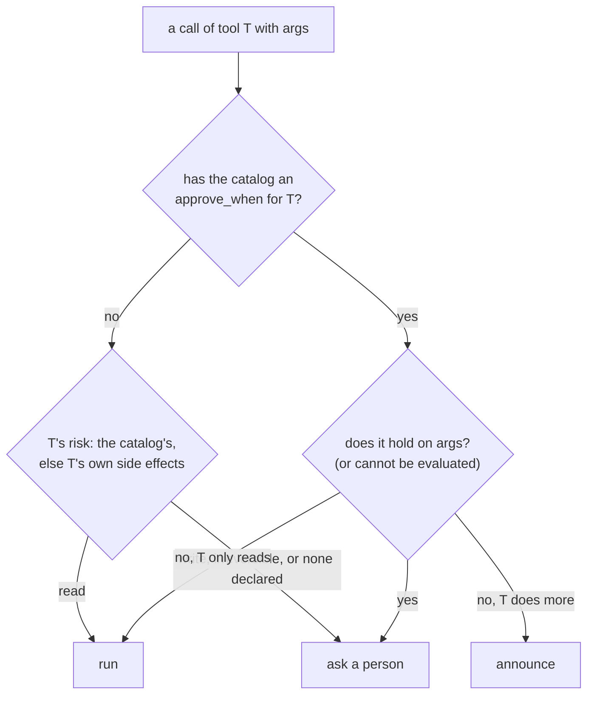

# Governance

Governance decides, for each tool call, one of three actions: the call **runs**, it runs and is
**announced**, or it **asks** a person first. `trellis.harness.governance` is the only place
this decision is made. Tools do not carry policy. A tool says what it does (its side effects),
and governance decides what that means for a call.

This page is how the decision is made, and what a wrapped agent (`h.wrap`, Way 1) does with
it: every harness tool call goes through governance with nothing to write. A team that keeps
its own framework checks its own tools with the same decisions, from the same catalog:
[blocks/governance.md](blocks/governance.md) (Way 2).

## How a call is decided



The decision starts from the tool's **risk**:

* For a local tool, it is the declared `side_effects`: `"read"`, `"write"` or `"irreversible"`.
  A tool that declares none has no risk of its own (below).
* For an MCP tool, the risk comes from its server's annotations, read with the protocol's
  defaults: `readOnlyHint` gives `read`; otherwise the tool is `irreversible` unless it says
  `destructiveHint: false`, which gives `write`. A tool with no annotations is `irreversible`.
* For an OpenAPI operation, the method decides it.
* A tool that says nothing of what it does has no risk of its own: its calls ask.

When the memory service's tool catalog has a `risk` for the tool, that risk wins. An entry
whose risk nobody declared (no `side_effects`, no `readOnlyHint` or `destructiveHint`) has none
(`null`), and the tool's own decides. The service
derives it from the annotations the harness published and from what an administrator set.

| Risk | Action |
|---|---|
| `read` | `run` |
| `write` | `ask`: waits for approval, once a conversation (below) |
| `irreversible` | `ask`: waits for approval, at every call |
| none declared | `ask`: waits for approval (`"<tool> has not declared its side effects."`) |

### A tool that does not say what it does

A risky call never runs on a guess. No tool is refused for saying nothing — as in Claude,
ChatGPT or MCP, it needs the person's permission: every call of it asks, whichever way the
tool came in. Saying what it does is what lets it run, so say it where you can.

| The tool | Where its side effects are said | When they are not |
|---|---|---|
| a function (`@tool`, `tool(fn)`, a bare function in `tools=[...]`, `governed(fn, gov)`), a source of your own | `side_effects=` (a source: on its `ToolSpec`) | each call asks |
| an MCP server's tool (`mcp(...)`, the gateway's, a framework's own MCP server) | the server's annotations | `irreversible`: each call asks |
| a LangChain tool of your graph | `tool.metadata = {"side_effects": "read"}` (or MCP-style `annotations`) | each call asks |
| an OpenAI Agents `FunctionTool`, a hosted tool, a CLI built-in the harness has no word on | nowhere in code (or build it with the harness: `@tool(side_effects=...)`) | each call asks |
| the harness's own tools, Deep Agents' and Claude Code's built-ins it knows | declared by the harness | — |

For a tool you cannot annotate — an MCP server you do not own, a framework's tool object — the
one place to say what it does is its `risk` in the catalog, where an administrator's word
overrides everything else and no publish changes it:

```python
await scope.advanced.tools.put_catalog([{"name": "docs-search", "side_effects": "read"}])
```

Until someone declares it there, the catalog keeps no risk for such a tool (an MCP tool that
says nothing is the exception: the harness publishes the protocol's `destructiveHint: true`),
and the harness's own rule decides: it asks at each call, and the person may allow it for the
conversation. With memory off there is no catalog, and the same holds.

### What the person picks

A call of a tool the harness runs that asks offers the person three choices, as Claude Code
does: **allow once** (this call), **allow for this conversation** (the tool's later calls in
every later run of the same thread for the same user — a resumed run, another worker and a
child run included; never another thread, user or tool) and **deny** (the call never runs; the
model reads why). An `irreversible` tool offers allow once and deny only: it asks at every
call. The approval's interrupt carries them as `options` (`governance.decision.CHOICES`; their
values: `once`, `run` — the contracts' `remember="run"` —, `reject`), and plain chat reads them
after the question ("Allow once, allow for this conversation, or deny.").

With a memory service there is a fourth choice, **always allow** (value `always`, the
contracts' `remember="always"`; `governance.decision.KEPT`; plain chat reads "Allow once, allow
for this conversation, always allow, or deny."): the tool's later calls asked of the same
person or role, in every conversation of that user, until the permission is revoked. The
harness keeps it in the memory service's tool permissions (`PUT /v1/tool-permissions`, with its
service key: an agent's or a user's own key is refused, so no agent allows itself a tool),
once, in the background (spooled like its other writes when the write fails), and reads the
user's permissions once per attempt, when a call first asks — so a revoke
(`DELETE /v1/tool-permissions/{id}`, `ctx.advanced.tool_permissions.revoke`) counts from the
user's next run. A call it covers runs announced ("pay is always allowed for you."). It is never
offered, and a kept permission never honoured, for an `irreversible` tool, where the tool's
`approve_when` decides the call (an administrator's rule, or an accepted suggestion) or where a
`before_tool` hook's `Ask` asks (your rule in code). It is offered only where a pick would be
kept: when the run's attempt could not read the user's permissions (the service away, a
refusal) or the key cannot grant (an issuer's token, a key restricted to some principals), the
person gets the three choices; while they cannot be read, the call asks (failing closed) and a
warning is logged once. Without a memory service the three choices stay. A framework's own
tools keep their own flow.

A `before_tool` hook's `Ask` is asked whatever was allowed beyond one call — for this
conversation, always, or by the schedule that fired the run — as a PreToolUse "ask" is in
Claude Code: it is your rule in code.

What the person allowed is read from the run store's history of every answered interrupt
(agent-runs' `resolutions`, append-only; `LocalRuns` keeps the same): the runs of the tenant,
user and thread, whichever agent or worker ran them, once per attempt and only when a call
asks. Nothing new is configured, and no code can allow a tool in advance: the catalog's risk
and `approve_when` stay the administrator's.

A write the run keeps to itself is announced as before, not asked: the harness's own schedule
tools (a schedule is confirmed when it is made, below), its memory tools (`memory_forget` of
the user's own words asks), its sandbox (`sandbox_exec`, `sandbox_write`), a sub-agent's call
(the sub-agent's own calls are governed) and Deep Agents' file tools and `execute`. A
framework's own tools under its own permission flow — Claude Code's and Kimi's built-ins, an
OpenAI agent's hosted tools — keep their own way: a `write` there is announced, and Claude
Code or Kimi asks its own way. An MCP tool, an OpenAPI `POST`/`PUT`/`PATCH`, an `a2a(url)`
agent and your own functions ask.

**A schedule set in chat.** `schedule_task` names the tools its runs will call that change
something (`tools`); those that would ask (a write, or one that says nothing; never an
`irreversible` one) are named in its confirmation: schedule it allowing them in its runs,
schedule it asking at each run, or do not schedule it. What the person allows is kept in the
schedule's metadata (`schedules.ALLOWED`) and honoured by every run it fires; a write it does
not cover pauses in the chat's thread, as any approval does. A schedule made from code
(`agent.schedule()`) allows nothing: its runs' writes ask.

The harness says which tools these are: when an agent's tools are listed, one warning
(`trellis.tools`) names those that declare no side effects, with what to add.

**`approve_when`.** The catalog may also hold an approval rule for the tool. The rule is set by
an administrator, or by someone who accepted an approval suggestion
(`POST /v1/tools/approval-suggestions/{id}/accept` in the memory service). A rule replaces the
risk's action: the call asks exactly when the expression holds on the call's arguments. When it
does not hold, the call runs, and it is announced unless the tool only reads.

```text
amount > 10000 and currency in ["EUR", "USD"]
shape == "amount:num:1e4"
```

The expression language belongs to the memory service. `trellis.memory.approval` writes and
validates the rules, and governance evaluates them with that same module, so there is one
implementation, not two. The language has comparisons, `and`/`or`/`not`, `in`, literals,
lists, dotted argument paths, and `shape`. `shape` is the call's argument shape, which approval
decisions are pooled by.

**Governance fails closed.** A rule that does not parse, or cannot be evaluated on a call,
asks. With memory off there is no catalog, and the tools' own risks decide.

Each call becomes a `Decision`:

| Field | Meaning |
|---|---|
| `tool`, `args` | the call |
| `action` | `Action.RUN`, `Action.ANNOUNCE` or `Action.ASK` (also `.runs`, `.announces`, `.asks`) |
| `reason` | why, in words: `"refund is irreversible."`, or the rule that held (`"amount > 100."`) |
| `risk`, `rule` | the risk governance used, and the approval rule, if any |
| `question` | what an approver reads: `"Approve <tool>? <reason>"` |

## One place for approval rules

When a call needs a person is a rule, and rules live in one place: **the tool catalog** in the
memory service — a tool's `risk` and its `approve_when`. Every framework, every process and
every worker reads the same rules, an administrator changes them without a deploy, and the
approvals people give are learned into suggested rules there.

| You want | Where it goes |
|---|---|
| a tool always asked about, or never | its `risk` in the catalog (`irreversible`, `read`); with memory off, its declared `side_effects` |
| asked by the call's arguments (an amount, a list of values, an id) | `approve_when` in the catalog: `amount > 100` |
| refused outright, rewritten, decided on data outside the call, routed to a reviewer or a screen of your own | a `before_tool` hook ([hooks.md](hooks.md)): custom logic, not a rule |

Set a rule from code (a deploy script) with the memory SDK — the same entry an administrator
edits:

```python
scope = h.memory.client.bind(tenant_id="acme", agent_id="refunds")  # your tenant's id
await scope.advanced.tools.put_catalog([{"name": "refund", "approve_when": "amount > 100"}])
```

There is no other rule mechanism: no rule in `h.wrap`, in `ReAct` or in a tool's code. A hook
whose only job is "ask when the amount is over 100" is a catalog rule written in the wrong
place — [hooks.md](hooks.md) and
[`examples/02_way1_react/hooks_guardrails.py`](../examples/02_way1_react/hooks_guardrails.py)
show the catalog way. A framework's own approval gate (LangChain's `HumanInTheLoopMiddleware`,
an OpenAI Agents `needs_approval` tool) still works, asked once with governance
([interrupts.md](interrupts.md)), and the harness says at `h.wrap` that its rule belongs in the
catalog.

## The catalog, kept fresh

Governance reads the catalog (`GET /v1/tools?names=`) for the tools it has been asked about, in
`trellis/harness/governance/catalog.py`:

* **Refresh.** The rules are read again after `GOVERNANCE_TTL_SECONDS` (30). The request is
  conditional: it sends `If-None-Match` with the last answer's `ETag`, and a `304` keeps what
  was read. A service that sends no `ETag` is read in full each time. So an administrator's new
  rule reaches running agents within half a minute.
* **New tools.** A tool asked about for the first time is read at once, together with the
  others.
* **One read at a time.** Concurrent calls that find the rules stale share one read.

Governance also publishes every tool to the catalog, so an administrator can see it and set
`approve_when` on it:

* MCP tools are published with their annotations, and never with side effects of the harness's
  making, so an administrator's stays.
* Local, OpenAPI and A2A tools are published with their declared side effects.

A tool is published once per content. A publish that failed is sent again the next time.

**A catalog that cannot be read** (the memory service is down, slow or refusing) does not fail
the call:

1. Rules read in the last `GOVERNANCE_STALE_SECONDS` (300) still stand.
2. Past that, or with none read, every tool that does more than read asks for approval, because
   whether an administrator wants its calls approved is unknown. The approver reads "… the tool
   catalog that says when it needs approval could not be read". A tool that only reads runs.
3. A warning is logged once (logger `trellis.governance`). The catalog is asked again every
   30 s, and its answer ends the fallback.

## Way 1: inside `h.wrap`

With `h.wrap`, governance is automatic. `Harness.governance(tenant)` keeps one `Governance` per
tenant. Its catalog is the memory service's, in that tenant (memory on), and its publishes go
through the harness's background writes, so they are kept on disk across an outage
([memory.md](memory.md)).

* **The toolbox** lists the tools and publishes them. It also asks governance which Code Mode
  servers only read ([tools.md](tools.md#code-mode)).
* **The bridge** (`tools/bridge.py`) checks every harness tool call, from any framework, then
  acts on the decision:
  * `run`: it runs the call;
  * `announce`: it emits `tool_notice` with the decision's risk, then runs the call;
  * `ask`: it pauses the run for approval (`InterruptReason.APPROVAL`, the call attached, the
    decision's `question`).

  Your code comes first, for what a rule cannot say: a `before_tool` hook may deny a call, or
  ask about one of an `assignee`, on your own screen
  ([interrupts.md](interrupts.md#who-reviews-on-which-screen-a-before_tool-hook)); it never
  approves one governance asks about. A tool the person allowed for the conversation
  (`remember="run"`) is not asked about again in it.

A call is looked up by its tool's name when it is made. So a rule set after a graph was compiled
still decides its calls, within the 30 s the rules are kept. This also holds
for a tool an OpenAI Agents handoff or a Claude server carries, and for the memory service's
own agent tools (their own risk decides unless the catalog names them). The span of each call carries
`trellis.governance.action` ([observability.md](observability.md)).

An approver answers with `agent.resume(interrupt_id, decision, ...)`
([interrupts.md](interrupts.md)):

| Decision | What happens |
|---|---|
| approve | the call runs |
| reject | the model is told the call was not run, and why when the reject carries a reason (`resume(id, "reject", answer="why", ...)`) |
| edit | the call runs with the edited arguments |
| cancel | the run ends `CANCELLED` |

Each decision is also `TOOL_CALL` feedback, from which the memory service learns approval
suggestions. It learns them per agent, from that agent's decisions, and lists and accepts them
in the agent's scope only. Governance reads them for each agent it governs calls of, at every
refresh of the catalog (at once for an agent it had not seen), and accepts each one
automatically, except for an `irreversible` tool, where a person accepts it. An accepted
suggestion is the tool's `approve_when` in the tenant's catalog. `trellis doctor --agent <id>`
lists the rules accepted for an agent; without `--agent` it lists those of the agents the key
may act as.

**Gate a tool in one place.** A framework's own approval gate pauses the run as the same
approval and takes the same decisions
([interrupts.md](interrupts.md#framework-approvals-langchains-middleware-and-openai-agents-needs_approval)).
Such gates are LangChain's `HumanInTheLoopMiddleware`, Deep Agents' `interrupt_on` and OpenAI
Agents' `needs_approval`. A tool both gate is asked once: governance counts the framework's
approval ([interrupts.md](interrupts.md#framework-approvals-langchains-middleware-and-openai-agents-needs_approval)).

**A framework's own tools** — those the framework runs itself, not the harness — are governed too, with nothing
added to the agent:
* every LangGraph tool node's calls inside a run — a `create_agent` or Deep Agents graph's, a
  Deep Agent's `task` sub-agents' (their own graphs), a hand-built graph's `ToolNode` — through
  the tool node's execution of a call, after the graph's own wrappers (installed once per
  process; outside a harness run nothing changes; `middleware()`'s `GovernTools` and `ReAct`'s
  own govern the same call once);
* an OpenAI Agents agent's `FunctionTool`s and its MCP servers' calls, on a copy of the agent and
  of every agent it hands off to or runs as a tool (`Agent.as_tool`: the tool runs the governed
  copy of its agent) — yours are not changed. Its hosted tools (file search, web search, code
  interpreter, a hosted MCP server's tools) run at the provider inside the model's step: they
  are recorded and in the catalog, but no approval can stand before them;
* Claude Code's built-ins and its MCP servers' tools, by its `PreToolUse` hook (below), and
  recorded by its `PostToolUse` hooks.

Each is of the run's tool set ([tools.md](tools.md#the-runs-tool-set)) and published to the
tenant's catalog, where an administrator's risk and `approve_when` govern it.

Each call is then decided as a harness tool's is — the catalog's risk, else the tool's declared
one (`tool.metadata["side_effects"]`, or MCP-style `annotations`), else none (it asks) —
asked when governance asks, journaled (a resume does not run it again), timed and traced. The
graph's state tools (`write_todos`, Deep Agents' file tools on its default
`StateBackend`) are let through: they change only the run's own state. Deep Agents' file tools
on a backend that writes to a real disk are not seen: give the graph governed tools instead.
Claude Code's built-ins go through the CLI's `PreToolUse` hook, where the harness decides them
by risk (`Read` runs; `Write` and `Bash` are announced), then Claude Code's own permission check;
what it would ask its user, a person is asked, unless the call only reads (a `Bash` command the
harness reads as read-only runs)
([frameworks/claude-agent-sdk.md](frameworks/claude-agent-sdk.md#claude-codes-built-in-tools)).
